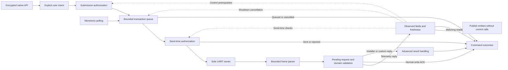

# Architecture

For user-visible control rules and stove observations, see
[Stove and Integration Behavior](BEHAVIOR.md). This document covers implementation.

## Boundaries

Python schemas run on the build host; C++ owns runtime behavior. YAML describes
entities, credentials and explicit opt-ins, not protocol scheduling or regulation.
One ESP device connects to one stove; the schema accepts a single Duepi hub.

The integration targets Air (room-air heating) controllers. Air/Hydro board-type
reporting is informational: it does not select a family-specific control profile
or reject Hydro commands. Hydro water/tank telemetry, hydraulic controls and
water-temperature targets are outside scope. See the
[controller families](PROTOCOL.md#controller-families) for the distinction from firmware variants.

| Surface | Responsibility |
| --- | --- |
| `protocol.h/.cpp` | Ten-byte codec, checked domains, fixed parser, semantic request construction |
| `transaction.h/.cpp` | Eight-slot queue, one pending request, ordering/coalescing, timeouts and quiet recovery |
| `state.h`, `control.h` | Observed fields/freshness, write authorization and startup profiles |
| `duepi.h/.cpp` | UART ownership, monotonic poll scheduling, entity publication and control submission |
| `tcp_emulator.h/.cpp` | Optional exclusive raw TCP forwarding and runtime HA switch; no protocol interpretation |
| `duepi_climate.h/.cpp` | HEAT/OFF, target temperature and power presets; no local thermostat |
| `privilege.h`, `privileged.h/.cpp` | Runtime-off one-shot capabilities, installer readback, custom diagnostic isolation |
| `installer.py` | Conditional installer entities and native API action registration from one build option |
| `automation.h/.py`, platform Python modules | ESPHome action/code-generation and entity bindings |

## Data Flow



Custom responses go to diagnostic data, never observed fields. Installer replies
remain parameter diagnostics. A checksum-valid response is not proof of query
identity; the wire protocol has no usable transaction identifier.
Command outcomes also include timeout/recovery results without a matched reply.
Advanced result handling can schedule installer readback or resynchronize polling,
as described below; it does not interpret custom replies as telemetry.

The optional TCP emulator bypasses this transaction flow only while its runtime
switch is on. The hub cancels pending transactions, invalidates observations and
blocks submission/send-time/installer gates before handing over the UART after
a timeout-plus-quiet drain. Its loop then runs only raw forwarding, never the
parser, scheduler or transaction engine. Switching off closes sockets and repeats
the drain before normal polling resumes. The bridge has a 512-byte TCP-output
buffer and processes at most 128 bytes per direction per loop. Partial socket
writes retain only unsent bytes; disconnects discard them. It is compiled only
with `USE_DUEPI_TCP_EMULATOR`, enabled by the `duepi.tcp_emulator` YAML block.

## Queue and Recovery

Reads occupy at most four of eight queue slots. Writes move ahead of queued reads;
one active transaction is never preempted. Unsent target/level changes coalesce.
Off cancels queued writes. Queue entries expire after five seconds. An Off queued
behind an active ignition waits through post-ACK synchronization, allowing
prerequisite reads ahead of it without resetting its queue age. Send-time policy
still applies, and UART recovery cancels the queued Off. Polling only queues work
when idle, including when Off alone is waiting for synchronization, so missed
intervals do not build a backlog.

The parser consumes bounded ten-byte frames with a 50ms inter-byte timeout; the
hub processes at most 64 RX bytes per loop. New sends wait until received UART
bytes are drained. A transaction deadline, including an expired reply arriving
before the next loop tick, triggers recovery rather than accepting the reply.

Timeout clears partial parsing, cancels queued work, invalidates the control
synchronization mask, disarms privileges and quarantines input until quiet. A
read receives at most one retry; a write is indeterminate and never retried.
Out-of-domain replies are ignored, except for unavailable target or power-level
feedback as described below. Unknown phase/alarm codes remain visible. Optional telemetry
does not establish core communication health.

The five additional diagnostics (`D200`, `DB00`, `DD00`, `DE00`, `D800`) are
polled only for configured entities. They use normal read timeout/recovery rules
and do not add control prerequisites. Corrections retain their raw first byte;
cycle time publishes two decimal byte fields as text and becomes Stale with
its observation. No diagnostic exposes a write path.

Optional initialization compatibility defaults off. The engine holds one
requested transaction while a separate firmware query runs, consumes that query's
reply, then rechecks queue age and send-time authorization before transmitting
the held request. Firmware queries do not recursively initialize. The held target
or level can still coalesce, and Off cancels held writes. Timeout/recovery or
runtime privilege disable cancels the held request too; a firmware-read retry
cannot release a previously cancelled command. Initialization replies update
firmware observations, never the held command's ACK or requested telemetry field.

After recovery, firmware, board, phase, room and alarm must be observed again
before writes. Normal ignition/off/reset ACKs also require resynchronization.
Custom sends cancel queued work and invalidate observations immediately; custom
completion adds quiet recovery. Installer ACK cancels queued work, prioritizes
parameter-specific readback and resynchronizes after the result. Physical effects
cannot be rolled back by queue cancellation or runtime disable.

## Shutdown Protection

An accepted Off blocks conflicting write submissions while it is queued,
initialization-held or active. On observing phase `0301`, `0801` or `0802`, the hub
cancels queued/held ordinary writes, including Off, while preserving recognized
reads, read retries and typed installer parameter writes. New ordinary writes and
custom/raw requests are blocked. Parameter writes, including standby, instead
require a known non-ignition phase and remain available while Off is pending;
explicit Off submission still cancels older queued parameter writes.
Cancellation never recalls an active frame or
replays work after shutdown. Cancellation is a distinct outcome from rejection,
timeout and an indeterminate transmitted write.

Eco phases are excluded from this blanket lockout: temperature changes and an
explicit Off retain normal authorization, while ignition and level restrictions
remain. Phase `0401` cleaning is not classified as ordinary shutdown. See the
[protocol reference](PROTOCOL.md#phases) for phase codes and write restrictions.

Periodic polling remains the source of phase observations; there is no per-write
phase query. Panel actions can occur before the next phase poll, and no cached-state
check can make a serial write atomic with a physical button press.

## State and Authorization

Desired commands never overwrite observations. The climate adapter publishes by
direct assignment, never by invoking its own control path. No desired command,
runtime privilege or arm is restored; API reconnect has no command callback.

Target-read transport completion is separate from semantic validity: a valid
frame carrying an unavailable setpoint completes the transaction but invalidates
the observed target. It does not force recovery or verify a pending write. The
hub separately retains the latest valid target reading or acknowledged target
request in RAM. Climate prefers a fresh reading, otherwise this retained value;
the numeric target sensor remains observed-only. The target-source diagnostic
distinguishes fresh reports, retained readings, acknowledged requests and unknown
values. Both retained sources are unverified, never persisted or replayed.
Rejected, cancelled and indeterminate writes cannot update the retained value.

Climate custom presets `Min`, `Low`, `Medium`, `High` and `Max` map to controller
levels 1 through 5 through the shared level-request entry point. They never imply
ignition or a temperature change.
Off-state selections are rejected without storing a choice or sending a command.
Default startup uses `F00n` at fresh controller-reported power, or level 1 when
power feedback is unavailable/stale. Explicit firmware profiles retain legacy start
overrides; firmware IDs no longer select these automatically.

During ignition/heating, requests and ACKs leave displayed power unchanged.
The preset/number is derived directly from a fresh `C500` field, gated by complete
synchronization and healthy core observations; no desired/local power cache exists.
Rejected and pending UI requests republish reported state. A fresh match verifies
the register; a mismatch publishes reported power and records both values.
Invalid feedback invalidates the sensor and controls without recovery. Recovery,
stale core telemetry or stale power hides the preset and makes the number unknown.
Fresh power remains visible during Off, eco and shutdown without authorizing writes.
Nothing is persisted or replayed and boot/reconnect only reads. A combined
preset/HEAT call while Off rejects the preset, then attempts Start using
reported/default power; no deferred level command is queued.
`D300` Fan Speed and `D400` Auger Level never verify selected power.

The frame parser validates printable payloads and checksum, preserving the raw
six characters alongside numeric decoding. Nonnumeric responses are accepted only
for firmware identity with an alphanumeric four-character identifier. Other
requests remain numeric. Identity is retained as text; the app's `RE8I` alarm
dictionary is selected by that exact ID, otherwise the app's default map applies.
Raw alarm codes remain visible and firmware changes refresh their text labels.

Semantic controls validate at enqueue and actual send. Each explicit installer
write or custom/raw send creates its own internal one-shot authorization and
reserves a single token with a monotonic expiry; actual send consumes it. All
buttons, API actions and YAML actions use these shared request entry points.
No arming button or YAML action is exposed. Disabling Installer Access clears both permissions
and cancels only queued advanced work, including initialization-held requests and
pending advanced retries. An already transmitted request is not undone.
Configured installer address bounds apply at submission and transmission to
reads, writes, standby and raw `L`/`S` parameter commands. Values remain bytes.
Installer address bounds and known non-ignition phase are rechecked. This policy
permits typed parameter writes in heating, cleaning, eco and ordinary shutdown;
all freshness, synchronization and one-shot requirements remain in force.
Custom access intentionally bypasses the semantic policy but still requires
configuration, runtime enable, fresh core state and one-shot authorization.
Ordinary-shutdown and pending-Off protection apply before this bypass and at
custom submission; custom payloads are never assumed read-only.
Raw payloads beginning with `S` additionally retain the installer ignition guard.

`enable_installer` opts into general installer, custom and raw capabilities.
It generates `USE_DUEPI_INSTALLER`, their configuration entities,
and native API actions when API is configured. Without the define, advanced hub
methods, permission state, protocol builders and automation implementation are
excluded by the preprocessor. Initialization remains independent. When included,
one Installer Access switch controls both permission paths and always starts off;
neither access nor command arming is restored from preferences. The examples
contain the normal entities. Reset and installer support remain independent
hub opt-ins; enabling runtime access never sends a stove command itself.

`standby_mode` independently includes `USE_DUEPI_INSTALLER` and one
`DuepiStandbySwitch`, without enabling general installer/custom/raw permissions
or generating their UI/API. Its own one-shot permission permits only its configured
address with byte 0/1. An internal request-origin marker is checked at transmission
and propagated to readback; disabling general access skips this work. It shares
the single installer verification path. End-of-cycle parameter polls use token 0
and do not overwrite the manual Installer Result. Only parameter reads publish
switch state; there is no startup restore/write, optimistic state or replay.
The last confirmed boolean remains visible on staleness or unsupported bytes.

The hub's configurable whole-Celsius command range defaults to 10..25, bounded
within the supported protocol range 10..35. It drives both control policy and
climate traits. These are software limits, not stove installer parameters;
observation decoding is independent so panel settings outside the configured
command range remain visible. There is no automatic alarm reset or fallback
target presented as a controller observation.

Optional minimum/maximum configuration numbers update this policy without using
the transaction engine. The hub validates finite
whole degrees and the complete ordered pair, republishes accepted values after
rejection, and stores the pair in one ESPHome entity preference. Setup restores
only a valid pair, otherwise retaining YAML defaults. Preference writes follow
ESPHome's normal flash batching. Climate traits read the current limits, but API
entity discovery carries those traits, not ordinary climate state updates; Home
Assistant may require an ESPHome integration reload to refresh the visual range.

ACKs are distinct from verification. Normal target/off/ignition/level verification is
limited to the latest command and a 15-second readback window. Level verification
uses only `C500`, not actual output or a proof of physical/panel behavior. Reset
remains unverified. Installer readback compares the same parameter
and token. Installer completion invalidates old observations even when access was
disabled before the write ACK and readback is skipped. Terminal readback rejection,
cancellation or timeout clears the verification busy flag, preserves an
acknowledged-but-unverified result and
restarts control-prerequisite collection without reentering engine cancellation.
New custom requests clear the previous response with Pending/Unavailable markers
including early input/access rejection. Custom diagnostic publication is restricted
to the latest attempt; older completions still perform their observation recovery
but cannot replace that attempt's result. No result proves safe physical operation, and a late unrelated reply
can still defeat correlation. Native API encryption provides transport security,
not fine-grained permissions or security for the controller's serial wires.

## Logging

Logging stays in the ESPHome hub/privileged adapter; the portable transaction
engine exposes a default no-op diagnostic callback for retries, initialization,
domain rejection and quiet recovery. No logger dependency is introduced into the
codec or engine. INFO records operator outcomes and observation/health changes,
not every poll. ACK logging remains distinct from verified readback. Read-timeout
and identical consecutive control-rejection warnings have 30-second monotonic
rate limits; parser errors are aggregated at most once per second at DEBUG.
VERBOSE contains fixed-size TX frames and accepted RX payloads. Serial logging
remains off.

## Development

Use Python 3.13 and the [development dependencies](../requirements-dev.txt).
ESPHome has a minimum-version requirement; the other dependencies are pinned.
Configure pip to use your required package index before installing. On Windows:

```text
py -3.13 -m venv .venv
.venv\Scripts\python.exe -m pip install -r requirements-dev.txt
.venv\Scripts\python.exe -m pip check
.venv\Scripts\python.exe tests/run_host_tests.py
.venv\Scripts\python.exe tests/test_config.py
.venv\Scripts\python.exe tests/validate_examples.py config
.venv\Scripts\python.exe tests/validate_examples.py compile
```

On Linux or macOS, create the environment with `python3.13 -m venv .venv` and
use `.venv/bin/python` in place of `.venv\Scripts\python.exe`. For unpublished
component changes, use a local source as described in
[device setup](CONFIGURATION.md#device-setup).

The host suites exercise the protocol/transaction engine and actual hub/climate
adapters, with installer support both included and excluded. Their fixtures are
synthetic/derived, not hardware captures. Schema tests cover configuration
validation and action registration.

The [validation runner](../tests/validate_examples.py) accepts `config` or
`compile`, optionally followed by `standard`, `controls`, `installer`, `standby`,
`installer-standby` or `c6-standard`.
Without a variant argument it checks all six. It creates temporary variants of
the C3 and C6 examples using the current local component source and public dummy
secrets. Logs and binaries stay under ignored `.validation-build`; the runner
never uploads, and its binaries must not be deployed. Compilation checks the
generated source, defines and ELF for installer inclusion/exclusion.

The [CI workflow](../.github/workflows/validate.yml) requires the repository secret
`PYTHON_PACKAGE_INDEX_URL`, pointing to an authenticated Azure Artifacts PyPI feed
with compatible development dependencies available. Configure this secret when setting up CI;
the workflow does not fall back to another package index. Pull requests without
access to the secret cannot run the dependency-backed job. Firmware compilation
is available as a manual workflow option.