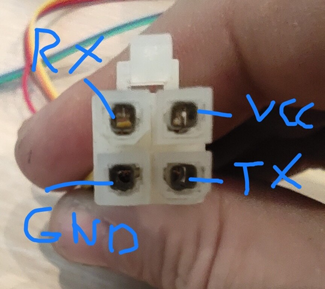
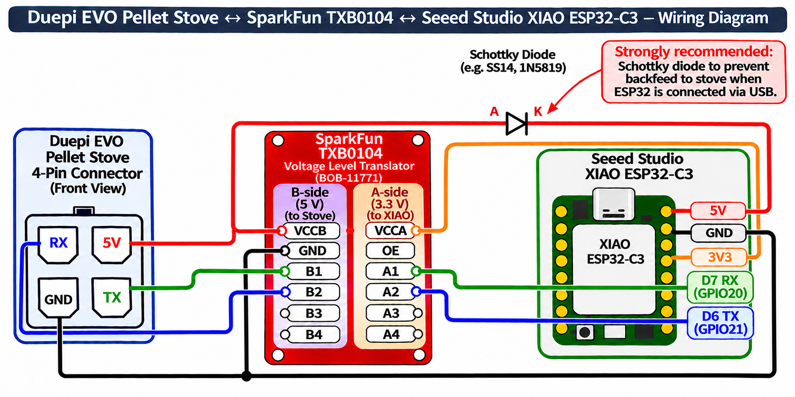
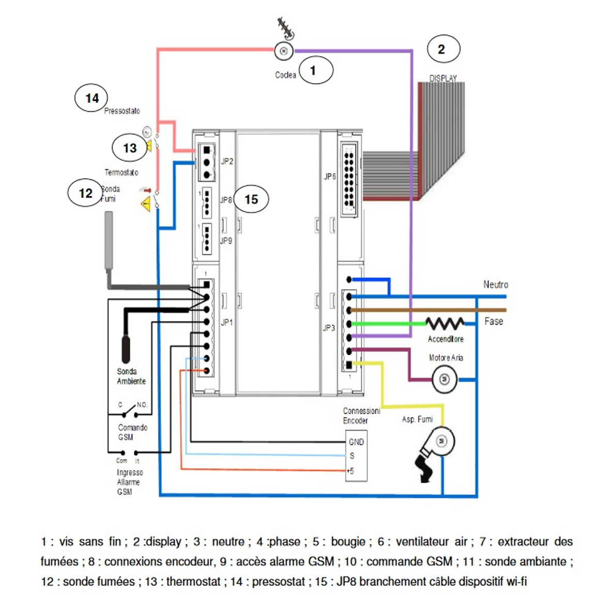
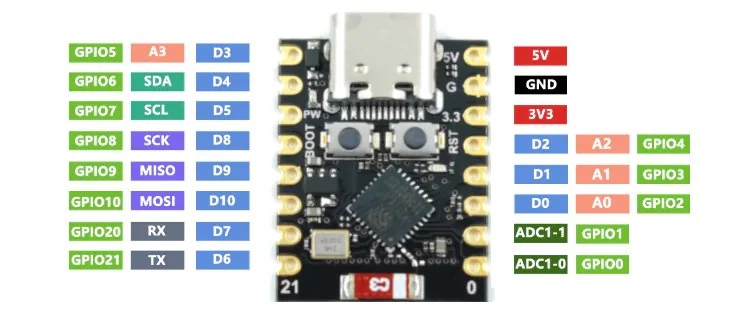

# Hardware Reference

Connector pinouts, cable color codes and connection notes for linking an ESP32
to a Duepi EVO stove controller. Wiring and electrical compatibility must be
verified for the particular controller and cable before connection.

## Duepi EVO WiFi Connector and Wiring

The external connector pinout and connector photo below accompany the **JP8**
WiFi cable color code observed on an Artel Next Petit 6 pellet stove. TX and RX
are named from the **stove controller's perspective**. This may not be a universal
Duepi pinout: wire colors may differ between cables. Verify the JP8 pin 1 location
and connector viewing direction on your hardware rather than inferring them
from the table order.

| Wire color | Function | JP8 pin |
| --- | --- | --- |
| White | **GND** | 1 |
| Orange | **RX ttl** | 2 |
| Red | **TX ttl** | 3 |
| Purple / Violet | **+5V** | 4 |

| External connector pinout | Connector photo |
| --- | --- |
|  |  |

## UART Connection

- Stove TX (JP8 pin 3) connects to ESP32 RX through the 5 V to 3.3 V channel
  of a suitable UART logic-level shifter.
- ESP32 TX connects to stove RX (JP8 pin 2) through the 3.3 V to 5 V channel
  of the logic-level shifter.
- For a non-isolated UART connection, stove GND (JP8 pin 1) and ESP32 GND share
  a common reference.

### XIAO ESP32-C3 and Sparkfun Wiring Example

This example shows a SparkFun TXB0104 level translator between the stove and a
Seeed Studio XIAO ESP32-C3, using GPIO20 for RX and GPIO21 for TX. Verify connector
orientation and the power arrangement against your hardware and the electrical
precautions below before following the diagram.

See below for detailed pinout and hardware references on ESP32 and the Sparfun.

**Please note:** do not connect the ESP32 both to the stove and USB at the same time, to prevent damage to your pc and the stove! Only connect
it to USB for initial flashing and then disconnect.

## Electrical Precautions

The tested stove's UART logic levels have been confirmed as 5 V with a multimeter.
Although users report working setups with direct ESP-to-pellet-stove connections,
ESP32 GPIO expects 3.3 V logic and is not 5 V tolerant. A suitable 5 V / 3.3 V UART
logic-level shifter (like the Sparkfun above) is advisable: a working direct connection
does not establish electrical safety, and 5 V on an ESP32 input can cause damage.

Verify the signal levels and interface requirements on your particular controller
before connecting either UART line. The +5V supply pin alone does not establish
the UART logic voltage. Do not connect JP8 +5V to an ESP32's 3V3 pin or assume the
stove supply can power an ESP board without checking its regulator, available
current and USB backfeed protection.

If on, let the stove complete its normal shutdown, then disconnect mains power before
changing wiring. Access to mains-powered internals is not needed. This should anyways be handled
by a qualified installer. Read-only firmware does not protect against electrical damage or incorrect wiring.

## Hardware Pictures

These pictures show example hardware and connections, not a verified wiring
diagram for every controller or ESP board. Confirm connector orientation,
pin numbering, GPIO assignments and electrical levels for your hardware.

### Duepi Controller Wiring Reference

### ESP Board Pinouts

#### Seeed Studio XIAO ESP32-C3

UART TX is D6 (GPIO21) and RX is D7 (GPIO20). This is the board used in the
configuration example. The pinout identifies the board pins; stove wiring and
electrical compatibility still need to be verified.

Reference: [Seeed Studio XIAO ESP32-C3 Pinout and Hardware Guide](https://wiki.seeedstudio.com/XIAO_ESP32C3_Getting_Started/).

#### Seeed Studio XIAO ESP32-C6

UART TX is D6 (GPIO16) and RX is D7 (GPIO17). Although the D6/D7 labels match
the C3, the GPIO numbers are different. Select the appropriate ESPHome board
target and update the UART GPIOs rather than using the C3 example unchanged.
This board has not yet been build-tested with this component.

Reference: [Seeed Studio XIAO ESP32-C6 Pinout and Hardware Guide](https://wiki.seeedstudio.com/xiao_esp32c6_getting_started/).

#### Seeed Studio XIAO ESP32-S3

UART TX is D6 (GPIO43) and RX is D7 (GPIO44). Although the D6/D7 labels match
the C3, the GPIO numbers are different. Select the appropriate ESPHome board
target and update the UART GPIOs rather than using the C3 example unchanged.
This board has not yet been build-tested with this component.

Reference: [Seeed Studio XIAO ESP32-S3 Pinout and Hardware Guide](https://wiki.seeedstudio.com/xiao_esp32s3_getting_started/).

#### ESP32-C3 SuperMini-Style Board

The image below matches the common ESP32-C3 SuperMini layout. It labels UART
RX as GPIO20 (D7) and TX as GPIO21 (D6). Check the actual board revision before
using this pinout.

This is not the Seeed XIAO ESP32-C3 used in the configuration example. Use the
correct ESPHome board target for your device and GPIO numbers for the UART pins;
matching UART pins do not make different board definitions interchangeable.

### SparkFun TXB0104 Level Translator Pinout

Reference: [SparkFun TXB0104 Hookup Guide and Pinout](https://learn.sparkfun.com/tutorials/txb0104-level-shifter-hookup-guide).