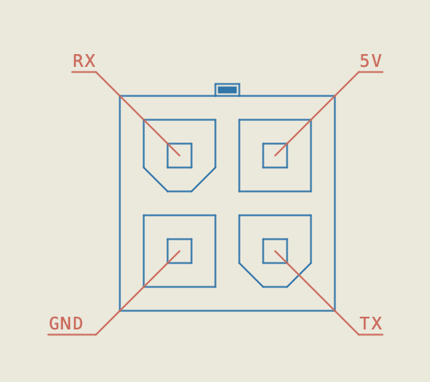
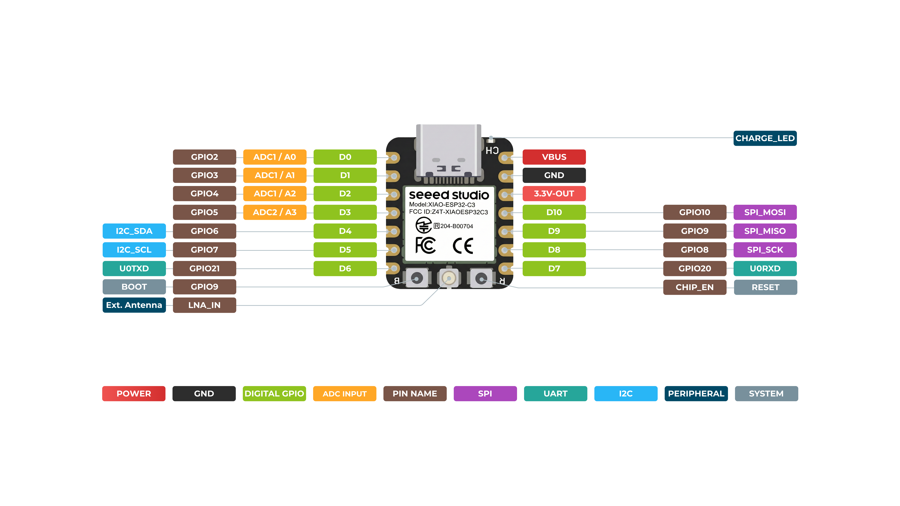
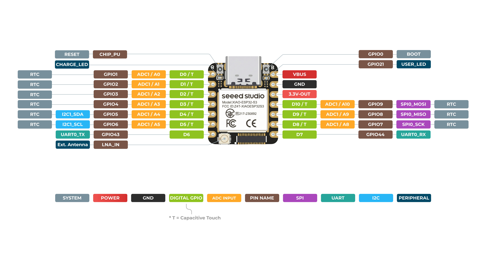

# Hardware Reference

Connector pinouts, cable color codes and connection notes for linking an ESP32
to a Duepi EVO stove controller. Wiring and electrical compatibility must be
verified for the particular controller and cable before connection.

## Duepi EVO WiFi Connector and Wiring

The external connector pinout and connector photo below accompany the **JP8**
WiFi cable color code observed on an Artel Next Petit 6 pellet stove. TX and RX
are named from the **stove controller's perspective**. This may not be a universal
Duepi pinout: wire colors may differ between cables. Verify the JP8 pin 1 location
and connector viewing direction on your hardware rather than inferring them
from the table order.

| Wire color | Function | JP8 pin |
| --- | --- | --- |
| White | **GND** | 1 |
| Orange | **RX ttl** | 2 |
| Red | **TX ttl** | 3 |
| Purple / Violet | **+5V** | 4 |

## UART Connection

- Stove TX (JP8 pin 3) connects to ESP32 RX through suitable level conversion
  if required by the measured UART voltage.
- ESP32 TX connects to stove RX (JP8 pin 2), with level conversion if required
  by the controller's input specifications.
- For a non-isolated UART connection, stove GND (JP8 pin 1) and ESP32 GND share
  a common reference.

## Electrical Precautions

ESP32 GPIO uses 3.3 V logic and is not 5 V tolerant. The +5V supply pin does not
establish the UART logic voltage. Verify the signal levels and interface
requirements before connecting either UART line; do not assume direct wiring is
safe. Likewise, do not connect JP8 +5V to an ESP32's 3V3 pin or assume the stove
supply can power an ESP board without checking its regulator, available current
and USB backfeed protection.

Let the stove complete its normal shutdown, then disconnect mains power before
changing wiring. Access to mains-powered internals should be handled by a
qualified installer. Read-only firmware does not protect against electrical
damage or incorrect wiring.

## Hardware Pictures

These pictures show example hardware and connections, not a verified wiring
diagram for every controller or ESP board. Confirm connector orientation,
pin numbering, GPIO assignments and electrical levels for your hardware.

### Duepi Controller Wiring Reference

### ESP Board Pinouts

#### Seeed Studio XIAO ESP32-C3

UART TX is D6 (GPIO21) and RX is D7 (GPIO20). This is the board used in the
configuration example. The pinout identifies the board pins; stove wiring and
electrical compatibility still need to be verified.

#### Seeed Studio XIAO ESP32-S3

UART TX is D6 (GPIO43) and RX is D7 (GPIO44). Although the D6/D7 labels match
the C3, the GPIO numbers are different. Select the appropriate ESPHome board
target and update the UART GPIOs rather than using the C3 example unchanged.
This board has not yet been build-tested with this component.

#### ESP32-C3 SuperMini-Style Board

The image below matches the common ESP32-C3 SuperMini layout. It labels UART
RX as GPIO20 (D7) and TX as GPIO21 (D6). Check the actual board revision before
using this pinout.

This is not the Seeed XIAO ESP32-C3 used in the configuration example. Use the
correct ESPHome board target for your device and GPIO numbers for the UART pins;
matching UART pins do not make different board definitions interchangeable.

